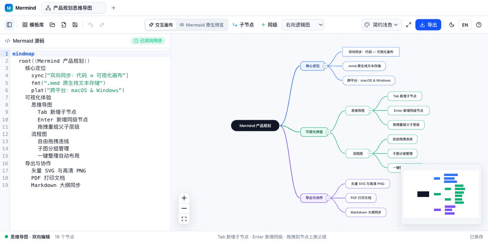
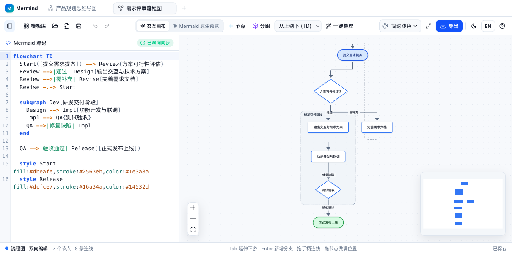
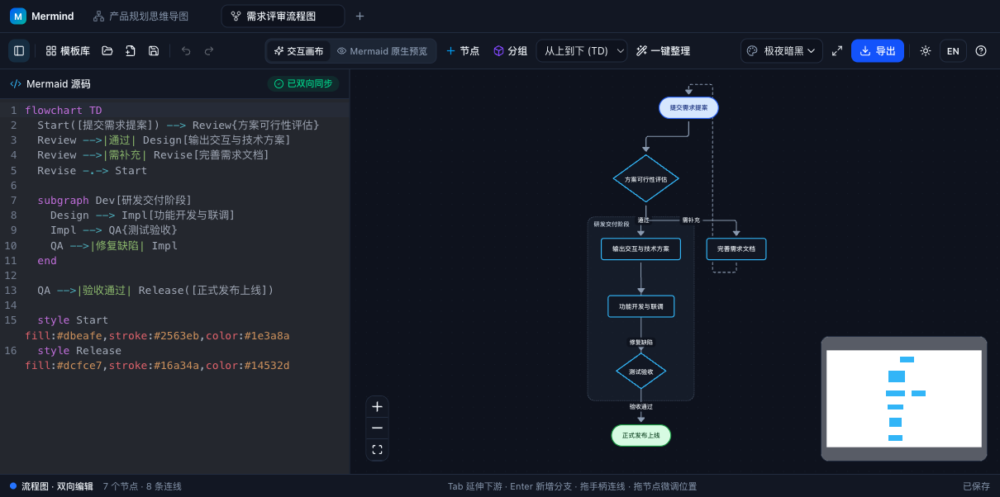

<p align="center">
  
</p>

<h1 align="center">Mermind</h1>

<p align="center">
  <strong>跨平台可视化思维导图 & 流程图桌面端软件 · 100% 双向实时同步标准 Mermaid 代码</strong><br/>
  Cross-platform visual Mindmap & Flowchart studio powered by bidirectional Mermaid code.
</p>

<p align="center">
  <a href="https://github.com/DancingLi/mermind/releases"></a>
  <a href="https://github.com/DancingLi/mermind/actions/workflows/ci.yml"></a>
  <a href="LICENSE"></a>
  
</p>

---

## 界面预览 / Screenshots

### 思维导图双向实时编辑（Mindmap Studio）


### 流程图可视化编辑与子图分组（Flowchart Studio）


### 极夜暗黑主题（Modern Dark Mode）


---

## 核心特性 / Features

- **代码 ⇄ 可视化双向实时驱动**：左侧内置 CodeMirror 6（Mermaid 语法高亮、行号、非阻塞容错提示），右侧提供流畅交互画布，任一侧修改即时同步，**源码始终保持 100% 标准 Mermaid 语法**，复制到 GitHub、Obsidian、Typora、Notion 均可直接渲染。
- **思维导图（`mindmap`）XMind 级键盘流**：
  - `Tab` 新增子节点并直接编辑、`Enter` 新增同级节点、`Shift + Tab` 节点升级、方向键快速穿梭、`Delete` 删除节点。
  - 支持拖拽节点更换父节点、点击折叠/展开分支、3 种布局模式切换（右向逻辑图 / 左右平衡导图 / 向下组织图）、7 种 Mermaid 原生节点形状。
- **流程图（`flowchart` / `graph`）交互建模**：
  - `Tab` 延伸下游节点、`Enter` 新增分支节点、拖拽手柄自由连线、编辑连线文字与 7 种连线样式（实线/虚线/粗线/双向箭头等）。
  - 支持 9 种流程图节点形状与 `subgraph` 分组容器、4 种流向切换（`TD`/`LR`/`BT`/`RL`）。
  - 默认自动分层布局；支持手动拖拽节点微调位置（仅对手动拖动节点写入标准 `%% @pos` 注释，不影响原生渲染），点击**「一键整理」**立即恢复自动布局并清理注释。
- **单节点自定义样式 + 多套精美主题**：内置简约浅色、极夜暗黑、商务海蓝、暖纸手账 4 套主题，并支持单节点/连线自定义填充色、边框色与文字色（自动写回标准 Mermaid `style` / `themeCSS` + `:::` 语法）。
- **全类型 Mermaid 兼容预览**：内置**「交互画布 / Mermaid 原生预览」**一键切换，贴入 `sequenceDiagram`、`classDiagram`、`stateDiagram`、`erDiagram`、`gantt` 等任意其他 Mermaid 代码均可实时预览并高清导出。
- **多标签文件管理 & 丰富导出**：
  - 原生读写 `.mmd` / `.mermaid` 文件（支持拖放打开、最近文件、多标签与本地草稿自动恢复），支持从 `.md` 文档提取 Mermaid 代码块导入。
  - 导出 **SVG 矢量图、高分 PNG（1x/2x/3x）、横版 A4 PDF、Markdown 大纲**，以及一键复制纯 Mermaid 或 Markdown 代码块。
- **中英双语 & 双平台桌面端**：默认简体中文，一键切换 English；提供 macOS（Apple Silicon & Intel）与 Windows 原生安装包。
- **一键发送到 DSH（DeepSeek Harness）**：工具栏「发送到 DSH」把当前导图的 Mermaid 源码连同附加的图片，直接发送到 DSH 当前显示的会话；图片可通过「图片」按钮选择，也可直接粘贴或拖入窗口。DSH 的回复写入与会话标题同名的 Markdown 文件，点击状态栏的「DSH · 会话名」即可打开。需要在 DSH 中安装 `dsh-mermind-bridge` 插件。

---

## 快捷键一览 / Keyboard Shortcuts

| 快捷键 | 功能 |
| --- | --- |
| `Tab` | 思维导图：新增子节点 ｜ 流程图：延伸下游节点 |
| `Enter` | 思维导图：新增同级节点 ｜ 流程图：新增分支节点 |
| `Shift + Tab` | 思维导图：当前节点升级 |
| `双击节点` / `F2` | 原地编辑节点文字 |
| `Delete` / `Backspace` | 删除选中节点或连线 |
| `↑` `↓` `←` `→` | 思维导图节点间方向导航 |
| `Cmd/Ctrl + Z` / `Shift + Z` | 撤销 / 重做（代码与画布统一历史） |
| `Cmd/Ctrl + \` | 展开 / 收起左侧 Mermaid 代码面板 |
| `Cmd/Ctrl + Shift + P` | 切换交互画布 / Mermaid 原生预览 |
| `Cmd/Ctrl + S` / `Shift + S` | 保存 / 另存为 `.mmd` 文件 |
| `Cmd/Ctrl + O` / `Shift + O` | 打开 `.mmd` 文件 / 从 Markdown 导入 |
| `Cmd/Ctrl + E` | 打开导出弹窗（SVG / PNG / PDF / Markdown） |
| `Cmd/Ctrl + 0` | 画布居中自适应缩放 |
| `Cmd/Ctrl + Shift + Enter` | 把当前导图（含图片）发送到 DSH 当前显示的会话 |
| `Cmd/Ctrl + V`（剪贴板为图片时） | 添加为发送附件 |
| `Cmd/Ctrl + /` | 查看快捷键指南 |

---

## 下载与安装 / Installation

前往 [GitHub Releases](https://github.com/DancingLi/mermind/releases) 下载对应平台的安装包：

- **macOS (Apple Silicon M1/M2/M3/M4)**：`Mermind-<version>-mac-arm64.dmg`
- **macOS (Intel)**：`Mermind-<version>-mac-x64.dmg`
- **Windows (64-bit 安装版)**：`Mermind-<version>-win-x64-Setup.exe`
- **Windows (64-bit 免安装便携版)**：`Mermind-<version>-win-x64-Portable.exe`

### 首次打开安全提示说明（开源未签名构建）

由于本项目为开源发布，当前构建未接入付费 Apple Developer / Windows EV 代码签名证书，首次启动可能会出现系统安全提示：

- **macOS**：将 `Mermind.app` 拖入「应用程序」后，若提示“无法验证开发者”或“已损坏”，请在终端运行一次以下命令解除隔离属性后即可正常打开：
  ```bash
  xattr -cr /Applications/Mermind.app
  ```
- **Windows**：若 Microsoft Defender SmartScreen 弹出蓝色提示框，点击 **「更多信息 (More info)」** → **「仍要运行 (Run anyway)」** 即可完成安装。

---

## 本地开发与构建 / Development

需要 Node.js 20+：

```bash
# 1. 克隆仓库并安装依赖
git clone https://github.com/DancingLi/mermind.git
cd mermind
npm install

# 2. 启动桌面端开发模式（Vite 热更新 + Electron）
npm run dev

# 3. 运行单元测试与类型检查
npm run typecheck
npm test

# 4. 打包生产安装包
npm run dist:mac    # macOS arm64 & x64 .dmg
npm run dist:win    # Windows x64 NSIS Setup & Portable .exe
```

---

## 开源协议 / License

本项目基于 [MIT License](LICENSE) 开源。
